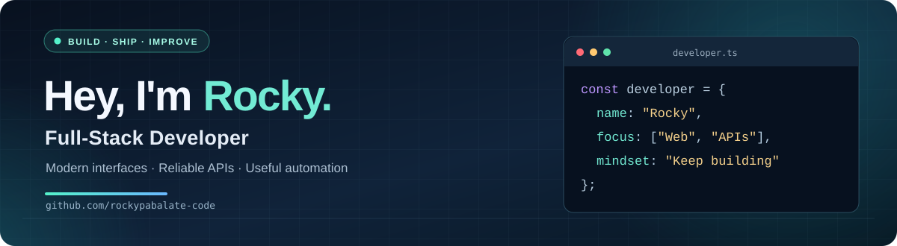

<!-- GitHub Profile README for github.com/rockypabalate-code -->

<p align="center">
  
</p>

<p align="center">
  <a href="https://github.com/rockypabalate-code?tab=repositories"></a>
  <a href="https://github.com/rockypabalate-code"></a>
</p>

<h3 align="center">Turning ideas and everyday workflows into useful software.</h3>

<p align="center">
  Building across the frontend and backend — from thoughtful interfaces to APIs and business tools.
</p>

---

### 👨‍💻 About me

- 🧩 I work on **full-stack web applications**, backend services, and workflow tools.
- ⚙️ I enjoy connecting **interfaces, APIs, and databases** into smooth end-to-end experiences.
- 📚 I'm always improving my approach to clean code, maintainability, and problem-solving.
- 🎯 My goal: **Build software that makes real work easier.**

### 🧰 Tech stack

<p>
  
  
  
  
  
  
  
  
  
  
</p>

### 🚀 Featured projects

<table>
  <tr>
    <td width="50%" valign="top">
      <h3>🖥️ QDMC Frontend</h3>
      <p>A frontend project built with Next.js, React, and TypeScript.</p>
      <p><code>Next.js</code> <code>React</code> <code>TypeScript</code></p>
      <a href="https://github.com/rockypabalate-code/Frontend-QDMC"><strong>View repository →</strong></a>
    </td>
    <td width="50%" valign="top">
      <h3>🔌 QDMC Backend API</h3>
      <p>Backend API development using Node.js, Express, and database services.</p>
      <p><code>Node.js</code> <code>Express</code> <code>Supabase</code></p>
      <a href="https://github.com/rockypabalate-code/backend-api-qdmcph"><strong>View repository →</strong></a>
    </td>
  </tr>
  <tr>
    <td width="50%" valign="top">
      <h3>⏱️ OT System Backend</h3>
      <p>Backend code for an overtime-management system.</p>
      <p><code>JavaScript</code> <code>API</code></p>
      <a href="https://github.com/rockypabalate-code/backend-ot-system"><strong>View repository →</strong></a>
    </td>
    <td width="50%" valign="top">
      <h3>✨ Frontend System</h3>
      <p>Frontend project and ongoing interface development.</p>
      <p><code>Frontend</code> <code>Web App</code></p>
      <a href="https://github.com/rockypabalate-code/frontend-system"><strong>View repository →</strong></a>
    </td>
  </tr>
</table>

### 💡 What I like building

```ts
const myFocus = {
  frontend: "Clean, intuitive user experiences",
  backend: "APIs that keep everything connected",
  automation: "Less repetition, more productivity",
  mindset: "Learn. Build. Improve.",
};
```

---

<p align="center"><strong>Thanks for stopping by!</strong></p>
<p align="center">Explore my repositories and follow along as I keep building.</p>
<p align="center">
  <a href="https://github.com/rockypabalate-code?tab=repositories">Projects</a>
  &nbsp;•&nbsp;
  <a href="https://github.com/rockypabalate-code">GitHub profile</a>
</p>
